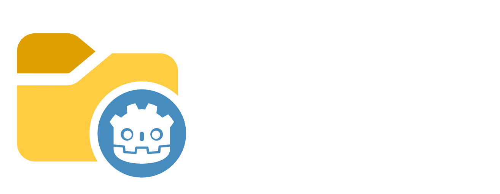
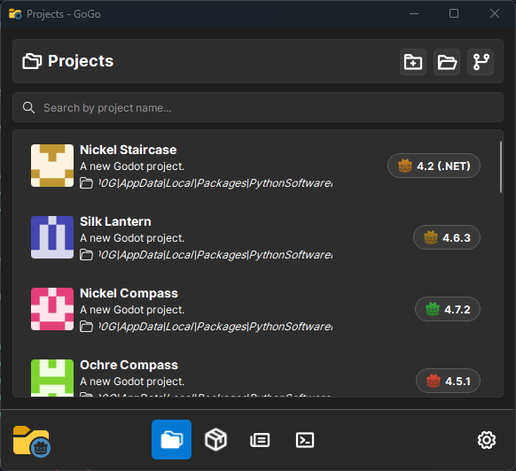

> **Status: early development.** There are no packaged releases yet, so you run it from source. Expect rough edges and breaking changes.

GoGo is a desktop app for managing [Godot Engine](https://godotengine.org/) versions and projects, with a small command-line interface alongside it.

## Preview



## Running from source

Requires Python 3.11+ and [uv](https://docs.astral.sh/uv/).

```sh
uv sync
uv run gogo          # opens the GUI
uv run gogo --help   # CLI
```

## CLI

The CLI currently covers engines only:

```sh
gogo engine list [--default] [--verbose] [--json]
gogo engine browse [--all] [--csharp] [--os OS] [--arch ARCH] [--max N] [--json]
gogo engine install VERSION [--csharp] [--path PATH]
gogo engine default [VERSION]
gogo engine start [VERSION]
```

Versions are printed as Godot writes them, e.g. `4.3.stable` or `4.4.rc2.mono`. Shorter
forms are accepted too: `4.3`, `4.4-rc2`, `4.3 mono`.

## Third-party notices

- **Godot Engine:** downloaded by GoGo, not bundled. [MIT License](https://opensource.org/licenses/MIT).
- **Godot logo:** used for branding. [CC BY 4.0](https://creativecommons.org/licenses/by/4.0/).
- **PySide6 (Qt for Python):** the GUI framework. [LGPLv3](https://www.gnu.org/licenses/lgpl-3.0.html).
- **Phosphor Icons**, via [kq_icon_engine](https://github.com/krosseye/kq_icon_engine): UI icons. [MIT License](https://opensource.org/licenses/MIT).
- **[GodotKit](https://github.com/krosseye/godotkit):** release fetching, downloads and project files. [MIT License](https://opensource.org/licenses/MIT).

## License

MIT © 2025 Killian W (krosseye)
